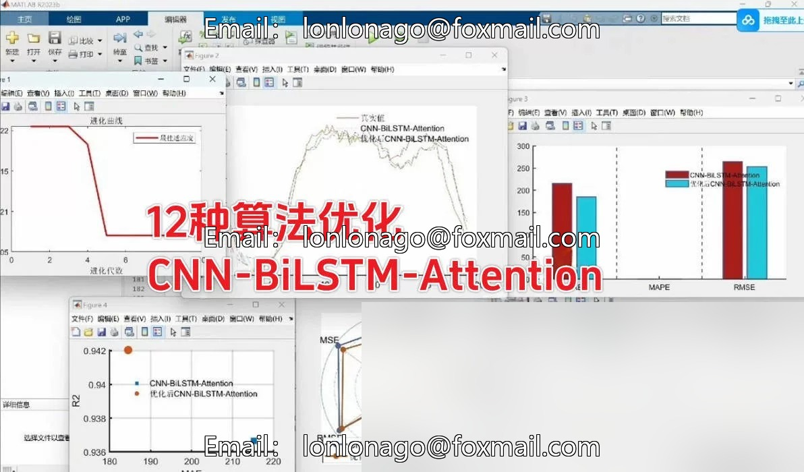

# 12 kinds of algorithm optimization CNN-BiLSTM-Attention multi-input

## Body

12 algorithm optimization of CNN-BiLSTM-Attention multi-input single-output prediction
matlab 2023

12 algorithms are as follows: Northern Goshawk Algorithm (NGO), Dung Beetle Optimizer (DBO), Grey Wolf Optimizer (GWO), Osprey Optimizer (OOA), Particle Swarm Algorithm (PSO), Subtraction-Optimizer Algorithm (SABO), Sand Cat Swarm Optimizer (SCSO), Sparrow Optimizer (SSA), Beluga Optimizer (BWO), RIME Optimizer (RIME), Whale Optimizer (WOA), Harris Hawk Optimizer (HHO).
After learning, new optimization algorithms can be added on your own, which is simple, convenient, and easy to understand.

Evaluation metrics include MAE, MAPE, MSE, RMSE, and R2.
The main functions are: Adopt 12 algorithms to optimize the parameters of the CNN-BiLSTM-Attention model (the 12 algorithms can be switched arbitrarily in the code!), and optimize the parameters by CNN convolution kernel count, learning rate, BiLSTM neuron count, and attention mechanism key-value. Results before and after optimization are also compared.

Code implementing the optimized CNN-BiLSTM-Attention model with any of the 12 algorithms, where the Attention model can be changed to single-head or multi-head, just changing a number in the code. The code comments have been written to show how to make the changes.

web-based shipment, can be directly photographed and shipped.

The dataset covers 12 algorithm-optimized CNN-BiLSTM-Attention multi-input single-output predictions, including algorithm switching and parameter adjustment, along with metrics and evolution curves.

<!-- AI_ENRICHED -->

## Images

## Payment

Here is a pay link on Stripe ( https://buy.stripe.com/3cs8yP7sY87d0vu9AB ). Please contact me lonlonago@foxmail.com after funding $89, and I will send you a complete data files , thank you!

